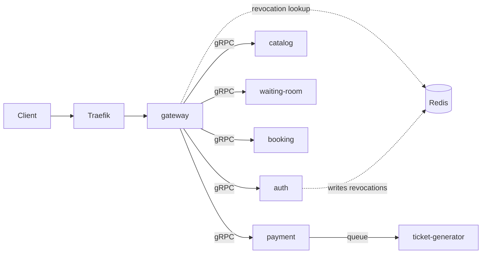

# Architecture

## Services

| Service | Language | Owns | Storage | Load peak |
|---|---|---|---|---|
| gateway | Go | JWT check, REST to gRPC, rate limit | none | always, follows traffic |
| auth | Go | sign-up, login, tokens | `auth_db` | before the sale (logins) |
| catalog | Go | events, venues, seat maps | `catalog_db` + cache | flat |
| waiting-room | Go | queue before the sale | Redis | before the sale |
| booking | Go | seat holds with TTL, no double booking | `booking_db` + Redis | at the start |
| payment | Go | orders, idempotent fake payment | `order_db` | 1 to 5 min after the start |
| ticket-generator | Python | PDF and QR, queue worker | none | after payments |

## Rules

- A service never reads another service's tables. It calls the service.
- One PostgreSQL instance, one database and one user per service.
- Only the gateway is public. Internal calls use gRPC.
- Every service is stateless except the stores.

## Request flow

1. The client calls the gateway with an access token.
2. The gateway checks the signature locally and asks Redis whether the token is revoked.
3. The gateway calls the internal service over gRPC.
4. A booking needs a waiting-room token, so bots can't skip the queue.
